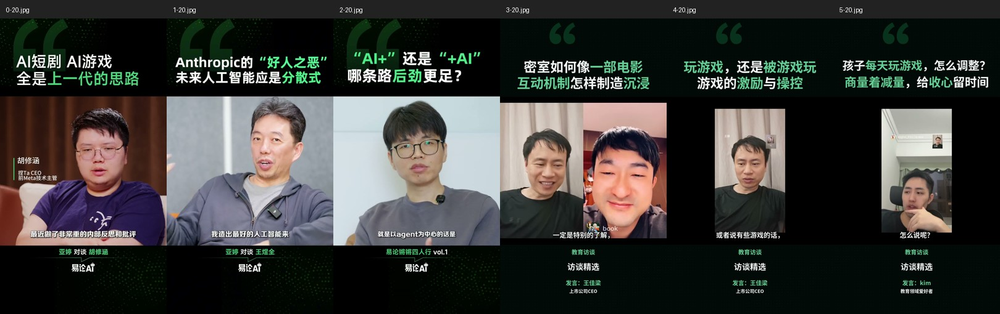
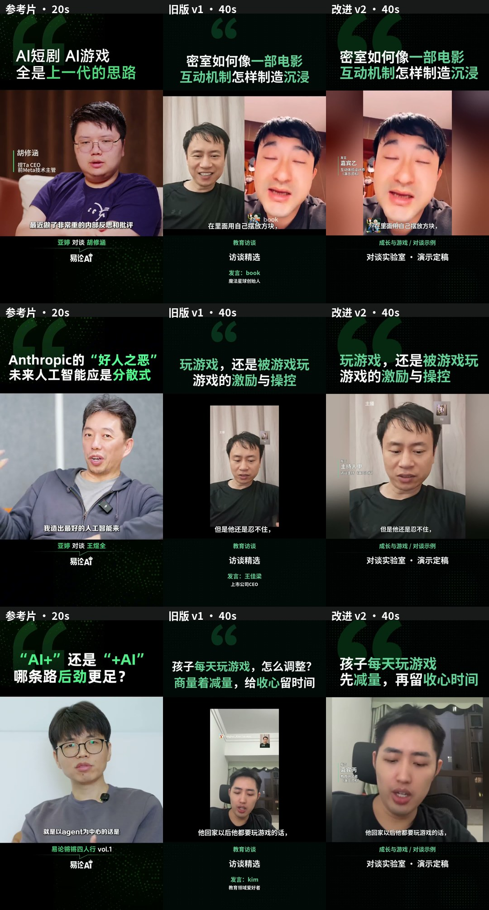

# 观点对谈 v2 对照与迭代

## 参照和基线

- 参考：`/Users/panyupeng/Downloads/视频下载` 的三条原始参考成片。
- 用户在 9400 检查的基线：`4bb131f2-ce24-47bc-8229-777d09d5038e`，三条 v1 切片。
- 测试复用该任务的正文和声音剪辑；第三条标题缩短为“孩子每天玩游戏 / 先减量，再留收心时间”。身份全部使用带“演示资料”说明的虚构称呼。
- 参照比较采用解码帧、参考原有的逐时抽帧和 Whisper 时间轴；本轮不声称人工全程试听。

## 差异、处理及剩余限制

| 维度 | v1 的问题 | v2 的处理 |
|---|---|---|
| 主体比例 | 竖屏录屏整张缩小，画面中有大片黑边、天花板，人物很小 | 检测主要脸部的稳定范围，裁去多余留白，完整保留脸及头部余量；小窗不会抢占主体 |
| 说话人镜头 | 长时间双人并排，无法像参考集中人物 | 新增按说话人填写左/右位置，确认后只取对应画面；未确认或检测不可靠时保留多人 |
| 构图稳定 | 直接缩放无人物比例控制 | 按连续源片段取稳定构图；合并相近裁框；短暂过渡保持相邻构图，避免几帧闪回全景 |
| 标题 | 居中、大小差异明显、引号偏小偏中 | 左缘90像素，两行统一字号；绿色关键词；大引号移到左上；未来选题优先短标题 |
| 字幕 | 字号和描边偏重 | 40px 白字，细描边，固定在窗口下沿 |
| 身份 | 人物资料远在底部，层级分散 | 小型绿色竖线信息条靠近人物；全景下避开脸移向肩部；明确“发言”，不冒充人脸身份识别 |
| 署名与底板 | 纹理太弱、底部多层信息堆积 | 固定栏目与品牌位置，分隔线；局部绿点阵；身份移出底部 |
| 开场 | 第一条问题约23秒，参考问题约6–12秒；第二条以依赖前文的话起头 | 新选题提示优先保留5–15秒完整问题、避开“回到刚才”等开场。本轮保留正文，便于独立比较视觉变化 |

机位质量仍受源素材限制：分屏单个画面本来很窄，v2 用该画面的柔和背景补边，无法凭空得到参考的宽幅摄影机背景；源视频已有的小窗、标记和低清晰度可能继续存在。检测是 OpenCV 的位置检测，不把人脸绑定到姓名。

## 实际迭代

1. 第一轮完整渲染：发现侧脸漏检导致回退频繁；身份条在双人画面上压脸；标题逐字符对齐让逗号抬高。保留日志和三条视频于 `tmp/editorial-v2/round1/`。
2. 第二轮完整渲染：显著改善主体比例；缩小身份条、调整全景位置；补充标点共用基线。检查发现已有左右位置时不必因少量侧脸漏检丢弃已确认的半幅画面，并修正补音频边缘形成的极短镜头。
3. 第三轮：保持头部余量及不可靠情况回退；完善已确认半幅机位的连续性；缩短第三条过长标题；写入独立 v2 历史。
4. 第四轮：对照第三条发现原录屏底部黑带被包含在裁框内。加入有效画面行边界检测，排除编码黑边和黑边上的小水印，同时保留暗色衣服；增加回归测试后重新生成三条。

5. 第五轮：去除底部黑带后，固定高度裁框曾把过多天花板带回画面。改为在保证头部和下巴完整的前提下缩短底部范围，增加该情形的回归测试，再次生成三条。

## 验证

144 项自动化测试通过。新增覆盖：主要人脸与小窗区分、明确左右位置、多人保留、裁框边界与头部余量、标题标点基线、模板版本去重及旧记录保留、不填写虚构姓名也可指定位置。一般模板回归通过。

## 最终成片与网页

同一行的旧版和新版取相同内容的40秒画面；参考取20秒，只比较视觉包装与人物比例，不表示三列是同一个人或相同内容。

第五轮最终任务：`59d0bc4d-7bde-469d-8faa-535d163c5924`。成片路径：`exports/auto-clips/59d0bc4d-7bde-469d-8faa-535d163c5924/`，9400浏览器首页“成片历史”最上方的“观点对谈 v2”记录可直接查看，品牌为“对谈实验室 · 演示定稿”。

| 成片 | 时长 | 模型原选题评分 | 自动质检 |
|---|---:|---:|---|
| 密室如何像一部电影 / 互动机制怎样制造沉浸 | 129.6秒 | 82 | PASS，转写相似度97.49% |
| 玩游戏，还是被游戏玩 / 游戏的激励与操控 | 240.6秒 | 87 | REVIEW，相似度97.21%，73.5秒附近重复口头词差异 |
| 孩子每天玩游戏 / 先减量，再留收心时间 | 102.3秒 | 77 | REVIEW，相似度96.59%，20.66秒附近“呢就是”差异 |

三条均完整解码通过、1080×1920、30fps；音画时长差为0.02767、0.00933、0.09398秒。响度为-14.77、-14.17、-14.29 LUFS。第五轮实测147.882秒（约2分28秒），包含重渲染和Whisper质检，**复用已有选句，不包含新的模型选题调用**。传播评分也沿用原选题结果，并非对v2画面的重新打分。

从对照图判断，标题、字幕、署名层级和“集中展示人物”的构图已接近参考风格；分屏素材的虚化补边、人物稍大的近景及手机画质仍明显不同，不宣称1:1复现。测量帧的参考主脸高度占窗口36%–42%，新版47%–57%；该数值是构图诊断，不是相似度或质量分数。第2/3条原先只有28%/25%，新版消除了主体过小与大片天花板的问题。

[第一条切机位检查](01-transition-check.jpg) · [第二条时间点](02-play-or-be-played-contact.jpg) · [第三条时间点](03-game-time-contact.jpg)

网页实际验证：新版历史恢复资料与左/右位置；旧版历史可打开；同参数再次提交返回同一run_id及reused=true；视频Range请求返回206。三条在浏览器从40秒播放至约52秒，readyState=4，无媒体错误或本页捕获的脚本异常。1280px桌面及390px手机表单检查无横向溢出。

[桌面结果](results-desktop.jpg) · [桌面资料](form-desktop.jpg) · [手机资料](form-mobile.jpg) · [运行摘要](run-summary.json) · [接口验收](api-check.json)

本轮主要验证模板画面。新增“缩短提问、避免依赖前文”的选题提示通过规则测试，但没有重新调用模型验证新选题效果；本轮仍保留第一条较长的提问及第二条依赖前文的开头。完整人工观看与发布审核仍待进行，两条语音REVIEW未被改写成PASS。

## 计划验收

| 计划项 | 结果 | 证据 |
|---|---|---|
| 参考测量与旧片定位 | 完成 | before.jpg、comparison.jpg、metrics.json |
| 构图、包装和输入配置 | 完成 | v2代码、144项测试、手机/桌面资料截图 |
| 同内容多轮真实渲染 | 完成 | 五轮记录；最终三条MP4及联系表 |
| 历史保留、版本去重、播放 | 完成 | api-check.json、run-summary.json、results-desktop.jpg |
| 画面接近参考 | 有条件达到 | 包装和主体聚焦已对齐；源机位/清晰度差异保留 |

以上为模板工程及画面对照验收，不代替成片内容与语音的发布审核。
