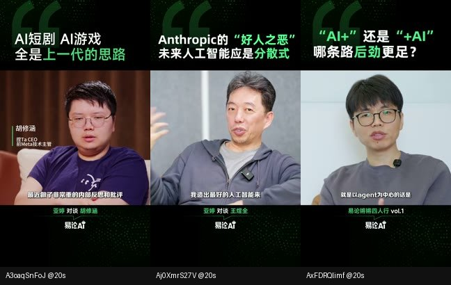
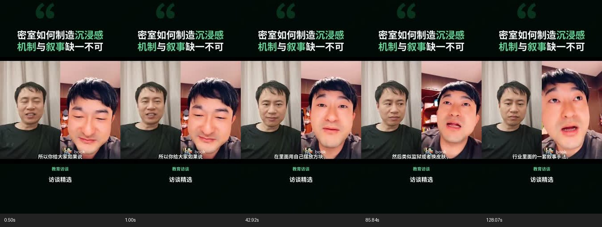
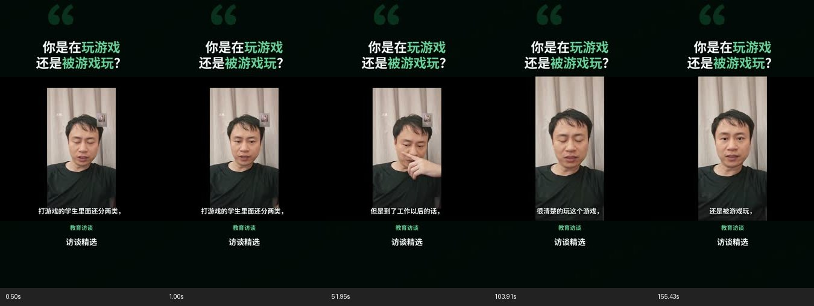
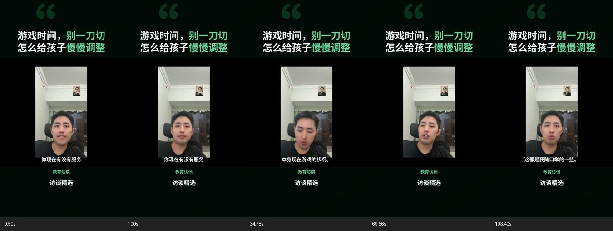

# 三条参考片拆解与第二模板验证

## 结论与证据

三条成片属于同一套可见包装风格，适合归纳为同一个模板。没有原工程，不能确认作者是否使用了同一个软件模板文件。

源文件均已下载到 `/Users/panyupeng/Downloads/视频下载/`。本次直接复用，没有再次下载。

| 文件 | 时长 | 媒体检查 |
|---|---:|---|
| wechat_A3oaqSnFoJ_1080p.mp4 | 149.697 秒 | 1080×1920、30fps、音频存在、完整解码无错误 |
| wechat_Aj0XmrS27V_1080p.mp4 | 162.367 秒 | 同上 |
| wechat_AxFDRQlimf_1080p.mp4 | 252.067 秒 | 同上 |

逐片每 8 秒抽帧（约 4、12、20 秒……），7 张联系表及原始 probe/解码日志/Whisper 时间轴位于 `tmp/reference-template/`。转写未逐字校对，本次未完成人工全程听音，因此不对配乐和声音设计作确定结论。以下视觉结论来自抽帧，不能排除极短的插入效果。

| 维度 | 三条共同点 | 差异及实现含义 |
|---|---|---|
| 标题 | 上方常驻两行白字，绿色强调关键词；20 秒及后续抽帧位置稳定 | 每片关键词和文案不同，模型输出标题及高亮词 |
| 底板 | 黑色/暗绿、点状纹理、大引号 | 新模板自绘底板，不复制原品牌 logo |
| 主画面 | 单一中央矩形窗口；字幕在其下部 | 原片具有原生单人机位；第三片约 180 秒出现三人全景，不应限定双人 |
| 署名 | 主画面下方的绿色栏目文字及白色品牌 | 栏目和品牌由用户输入；不默认填参考作者资料 |
| 身份 | 第一条约 20 秒有嘉宾身份条 | 三条并非每帧都有；新模板姓名/身份可选填，并标为“发言”放在画面外，避免把声音 ID 当成人脸定位 |
| 结构 | 自然问题/观点引入，展开论证和例子，落在自然收尾 | 149–252 秒；新预设容纳 60–300 秒，目标 90–270 秒 |
| 节奏 | 大段保留发言者镜头，穿插原有对话或反应镜头 | 不套一般模板的固定近中景循环，不重复冷开场，不新增白闪、红卡和 CTA 尾卡 |

模板的本质是：**让一个完整观点通过连续论证成立，用固定的视觉层级帮助理解和识别栏目。** 单纯改黑绿配色并不足以复现这一点。因此第二预设同时更换选题提示、时长规则、时间顺序校验及镜头编排。

## 使用与边界

首页“自动切片”中选择直播 → “观点对谈” → 可选填资料 → 开始转换。

- 人物资料按已标注的说话人 ID 填写；资料未知时留空，不生成虚构身份。
- 已有左右分屏完整保留，源视频自带切机位时也保留。不会从音频 ID 推断人脸位置，不能把固定分屏素材变成参考中的真实多机位。
- 同一直播、同一模板及相同资料复用已有任务；资料改变产生新记录，原成片保留。
- 所有历史在 `exports/auto-clips/<run_id>/`；“一般”预设的原有画面规则保留。

## 验证进展

- 自动化：136 项通过；覆盖模板合同、真实 FFmpeg 渲染、身份资料边界、模板/资料去重和持久化、AI 提示和错误重试。JavaScript 语法检查通过。
- 真实运行首次发现模型把秒数作为句子 ID。原校验正确拒绝，但校验位于重试之外；已将其纳入最多一次反馈重试，增加失败回归测试，保留错误证据。失败任务 `3d8dbb14-3d16-423d-a506-5f8f29b2fa69` 未删除。
- 网页：1280×900 桌面、390×844 手机视口验证无横向溢出。切换素材时资料隔离，切回保留草稿；一般模板隐藏新资料；打开历史恢复保存的品牌/栏目和空身份；更改资料后按钮为“开始转换”，原资料为“查看转换进度”。见 [桌面](desktop.jpg)、[手机](mobile.jpg)。
- 真实直播：《孩子沉迷游戏怎么办？》，时长 118 分 30 秒，已标注说话人。通过网页提交“观点对谈”，品牌“访谈精选”、栏目“教育访谈”，人物资料留空。运行 `5a53ea01-0930-44bc-9909-bdbe09e7cd6d` 生成 3 条，耗时 **342.903 秒（5 分 43 秒）**，包含模型选题、渲染和 Whisper 质检，不含已有转写/标注。阶段：选题 241.007 秒、渲染 74.835 秒、质检 25.948 秒。
- 同参数 API 再次提交返回同一 run_id 且 reused=true；视频 Range 请求返回 206 和正确的 1024 字节片段。网页实际播放验证：readyState=4、1080×1920，播放时间推进到 6.529 秒、无媒体错误；本页 error/unhandledrejection 监听无记录。见 [成片页面](results.jpg)。

| 成片 | 时长 | 模型传播潜力 /100 | 自动质检 |
|---|---:|---:|---|
| 密室如何制造沉浸感 / 机制与叙事缺一不可 | 130.07 秒 | 82 | PASS；转写相似度 96.38% |
| 你是在玩游戏 / 还是被游戏玩？ | 157.43 秒 | 86 | REVIEW；相似度 96.25%，约 67.74 秒有重复口头词差异 |
| 游戏时间，别一刀切 / 怎么给孩子慢慢调整 | 105.40 秒 | 82 | REVIEW；相似度 96.62%，约 21.94、63.92 秒有词句差异 |

三个 MP4 均通过完整解码、1080×1920 H264/30fps/AAC、响度检查；音画时长差为 0.039、0.01567、0.06 秒。详见 [运行摘要](run-summary.json)。评分是模型主观判断，不是传播效果的实测结果。

抽帧已人工查看。第一条完整保留左右对谈；后两条源素材为竖屏单人/小窗，安全容纳在中央窗口，因此有较宽侧边留白。此版本不擅自放大裁掉人物或小窗；要达到参考片的宽幅近景，需原生机位或明确裁切范围。抽帧检查不能替代完整观看；两条 REVIEW 保留原质检状态，没有把疑似转写差异宣称为已修复。

## 验收记录

| 计划项 | 状态 | 证据 |
|---|---|---|
| 参考拆解和下载确认 | PASS | 三份媒体日志、七张联系表、上方对比 |
| 独立合同/选题规则 | PASS | 测试及真实模型结果；一般模板回归通过 |
| 确定性渲染 | PASS | 三条真实 MP4、技术质检和抽帧 |
| 网页资料/历史/去重 | PASS | 桌面手机截图、资料恢复和真实重复提交 |
| 回归和全链路运行 | PASS | 136 项测试；完整运行 342.903 秒 |

本表为系统功能验收，5 PASS / 0 FAIL / 0 BLOCKED。成片发布审核独立：1 条自动 PASS、2 条 REVIEW，三条均未人工全程试听。
